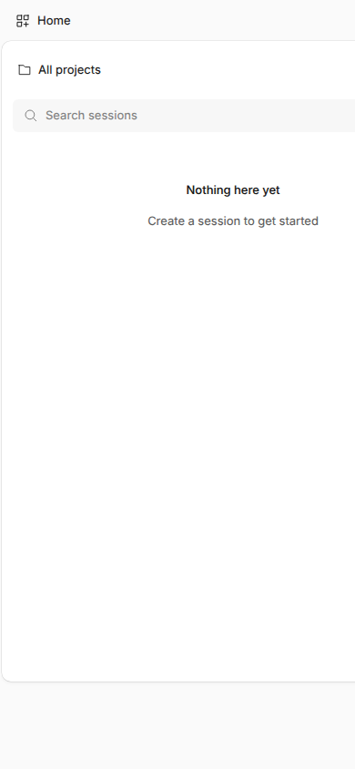
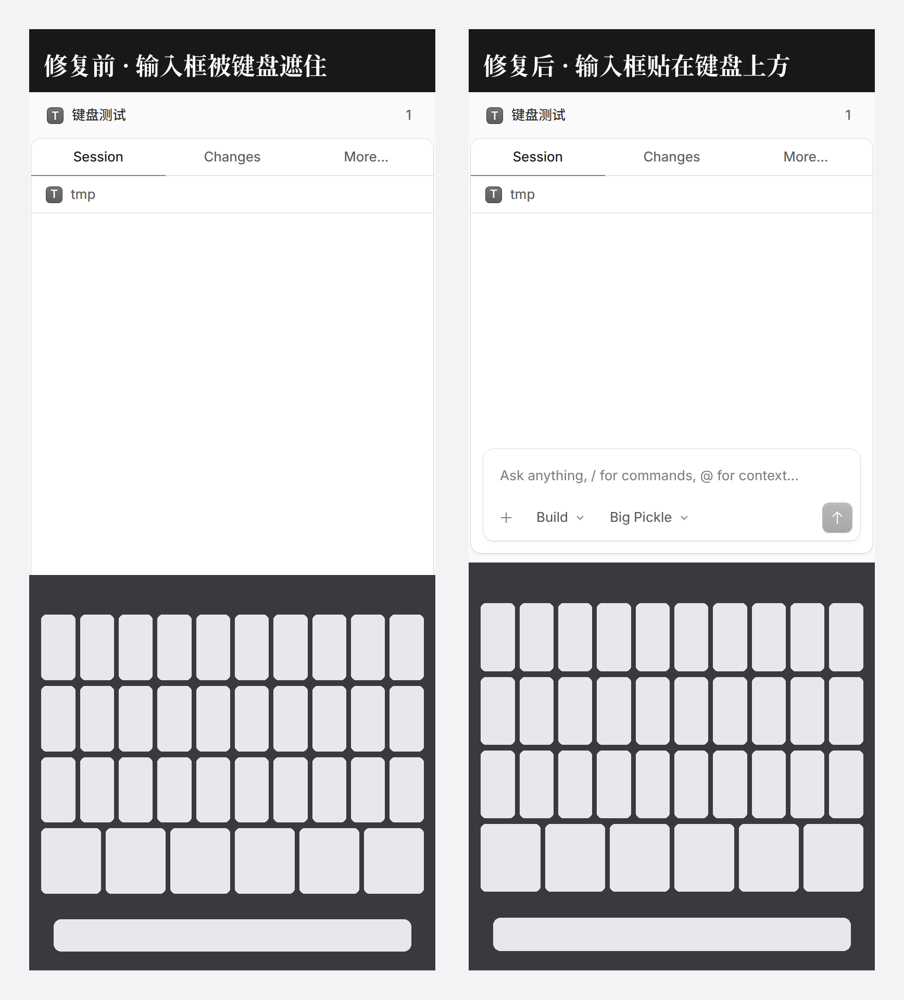

# OpenCode Android APK 可行性分析

> 仓库：[anomalyco/opencode](https://github.com/anomalyco/opencode) v2.3.0（MIT）
> 分析时间：2026-11-14 · 结论：**可行**（客户端形态），已产出可安装 APK 验证

---

## 一、结论

| 问题 | 结论 |
| --- | --- |
| 能不能做出 APK？ | 能。已完成 v0.1.0，`OpenCode-Mobile-0.1.0-release.apk`（6.1 MB）可直接安装 |
| 能不能把 agent 塞进 APK 离线跑？ | **不能**（技术路线不成立，见 §3.4） |
| 最合理的形态是什么？ | 手机作「远程客户端」，电脑/服务器跑 `opencode serve` |
| 工作量 | MVP 1–2 人日（本次已完成），上架级 1–2 周 |

一句话：**opencode 本身就是"服务端 + 多客户端"架构，Web 端已经是一个移动端适配完整的 PWA，Android 只需要一个高质量的原生外壳。**

---

## 二、仓库事实（不是猜测，逐条可查）

| 维度 | 数据 |
| --- | --- |
| 版本 / 许可 | v2.3.0 / MIT |
| 仓库规模 | 33 个 workspace 包、6,234 个 TS/TSX 文件、约 121 万行 |
| 技术栈 | Bun 1.4.4 运行时、Effect 4.1（HttpApi）、SolidJS + Vite 7、Tailwind 4 |
| HTTP API | 170 个端点（`packages/protocol/src/groups/*`），另有 SSE/事件流 |
| 关键包 | `cli`（Bun 可执行文件）、`server`（HTTP 服务）、`app`（Web UI）、`desktop`（Electron） |

架构链路：

```
packages/cli  ── opencode serve ──►  packages/server (Effect HttpApi, 170 endpoints)
   │ 内嵌 app/dist 静态资源                │
   │ (app-assets.ts, brotli 打包)          ├─► 会话/工具/PTY/文件系统/LSP/MCP
   ▼                                       │
浏览器 / WebView  ◄──── 同一个 origin 托管 Web UI (web-ui.ts)
   ▲
   └─ packages/app：Solid + Vite，PWA（manifest display:standalone）
```

`packages/desktop` 也只是 Electron 外壳 + 把 CLI 作为 sidecar 子进程拉起，**说明"壳 + 本地服务"是这个项目的既有范式**。

---

## 三、决定可行性的四个关键发现

### 3.1 服务端直接托管完整 Web UI（最关键）

`packages/cli/src/services/web-ui.ts:15-30`：除 `/api/*` 和 `/auth/*` 外，所有路径都落到内嵌的 `app/dist` 静态资源；`app-assets.ts` 在打包时把 Web 构建产物 brotli 压缩进 CLI 二进制。也就是说：

- **不需要**单独部署前端，不需要 CDN，不需要 `npm run dev`
- 客户端只要访问 `http://<host>:4096/` 就能拿到完整界面

实测（本机 `opencode serve`，v2.3.0）：

```
$ curl -s -o /dev/null -w "%{http_code} %{size_download}\n" http://127.0.0.1:4096/
200 9162

$ curl -s -u opencode:<password> http://127.0.0.1:4096/api/info
{"version":"2.3.0","pid":45789,...,"capabilities":{"persistentPty":true}}
```

### 3.2 鉴权与配对链路是现成的，天然适配移动端

| 机制 | 实现 | 对 Android 的意义 |
| --- | --- | --- |
| Basic Auth | `authorization.ts:34-46`，`WWW-Authenticate: Basic realm="Secure Area"` | WebView 的 `onReceivedHttpAuthRequest` 可直接自动填充，无需改造服务端 |
| Session Cookie | `auth.ts:16`，`SESSION_TTL_SECONDS = 30 天`，HMAC 签名，改密码即失效 | 手机"登录一次，30 天免密" |
| 配对码 | `pairing.ts:7`，5 分钟 TTL、一次性（`invalidateWhen`） | 扫码/点链接即登录，不用手输密码 |
| 配对二维码 | `cli/commands/handlers/pair.ts`，QR 内容是 `{"code","urls"}` JSON | 手机端已能解析该 payload（见 `ServerInput.kt`） |
| 连接端点 | `/auth/connect/:code`（`protocol/groups/server.ts:35`） | 落地页，成功后种 cookie 并跳转 |

### 3.3 Web UI 已经做过移动端适配

| 证据 | 数量/内容 |
| --- | --- |
| 响应式断点 | `@media (max-width: …)` 9 处 + `@container` 查询 14 处 + Tailwind 响应式前缀 75 处 |
| 运行时判断 | `matchMedia` 22 处（布局在 JS 里也会按宽度切换） |
| `env(safe-area-inset-*)` | 26 处，含刘海/home indicator |
| 手机专用组件 | `shell/mobile-drawer.tsx`、`shell/mobile-panel-drawer.tsx`、`servers/connect/scanner.tsx`（摄像头扫码） |
| 视口 | `viewport-fit=cover` + `interactive-widget=resizes-content`（键盘不遮输入框） |
| PWA | `manifest.json`：`display: standalone`、maskable 图标、`sw.js` |

390×844 实际渲染（通过配对链接登录后截图，`docs/web-ui-mobile.png`）：



### 3.4 为什么"把 agent 打进 APK"不可行

| 依赖 | 现状 | 阻塞点 |
| --- | --- | --- |
| 运行时 | Bun 1.4.4（`Bun.file`、`Bun.serve`、`Bun.spawn` 散落各处） | Bun 无 Android/bionic 目标，官方也不提供交叉编译 |
| 数据库 | `bun:sqlite`（`core/src/database/v1-migration.bun.ts:808`） | 与 Bun 绑定，Node/Android 均无对应实现 |
| 终端 | `@lydell/node-pty` 预编译二进制 `cli/package.json:60-65`：darwin-arm64/x64、linux-arm64/x64、win32-arm64/x64 | **没有 android**，PTY 是实现会话执行的核心 |
| 其他原生 | `@ff-labs/fff-bun`、`@silvia-odwyer/photon-node` | 均为平台预编译包 |
| 现有先例 | `packages/desktop` 把 CLI 作为 **sidecar 子进程**分发 | 桌面端自己也没把服务塞进渲染进程 |

要在端内跑，等于重写 Bun 运行时 + 移植 PTY + 换掉 SQLite 驱动，量级是数月级，且与上游演进持续冲突。

---

## 四、方案对比

| 方案 | 做法 | 可行性 | UI 复用 | 工作量 | 结论 |
| --- | --- | --- | --- | --- | --- |
| **A. 原生壳 + WebView**（本次交付） | Kotlin/Compose 壳，加载 `opencode serve` 的 Web UI | ✅ 已验证 | ~95% | 1–2 人日 | **推荐 MVP** |
| B. TWA（Trusted Web Activity） | 把 PWA 装进 Chrome 自定义标签 | ⚠️ 有条件 | ~95% | 0.5 人日 + 域名 | 需要 **HTTPS 域名 + assetlinks.json**，局域网 `http://ip:4096` 直接不可用；上架可考虑 |
| C. 纯原生 Compose 客户端 | 直连 170 个 REST 端点 + 事件流 | ✅ 但很重 | ~0%（需重写 UI） | 6–10 人周 | 二期演进方向 |
| D. Capacitor/Cordova 打包 Web 资源 | APK 内置静态资源，运行时连远程服务 | ⚠️ | ~95% | 2–3 人日 | 与 A 等价但多一层 JS 桥；`connect-src *` 已放开，可行 |
| E. 端内运行 server | Bun/PTY/SQLite 上 Android | ❌ | — | 数月 | 不建议（见 §3.4） |

**选择 A 的理由**：能在同一局域网内直接用 `http://` 访问（TWA 做不到），能自动处理 Basic Auth、相机扫码、麦克风、文件选择、返回栈，且完全复刻官方 UI 与交互——升级只需跟随服务端，客户端零改动。

---

## 五、已交付的原型（v0.2.0）

### 5.1 技术参数

| 项 | 值 |
| --- | --- |
| 语言/框架 | Kotlin 2.0.21 + Jetpack Compose（Material 3） |
| 构建 | AGP 8.7.3 / Gradle 8.11.1 / JDK 17 |
| SDK | compileSdk 35，minSdk 26（Android 8.0+），targetSdk 35 |
| 包名 | `ai.opencode.mobile` |
| 体积 | debug 9.1 MB / release 6.1 MB |
| 权限 | INTERNET、ACCESS_NETWORK_STATE、CAMERA、RECORD_AUDIO |

### 5.2 功能清单

**连接页**（原生 Compose，深色，取自 Web 端设计令牌 `#080808` / `#A2BCFF`）
- 服务器地址解析：`192.168.1.10`、`ip:port`、`http(s)://…`、带路径前缀的反代地址
- `opencode pair` 的**配对链接**与**二维码 JSON** 粘贴后自动解析为 `/auth/connect/<code>`
- 可选密码（Basic Auth），最近连接列表（可移除），启动服务命令提示

**浏览页**（WebView 宿主）
- JS / DOM Storage / 多窗口 / 媒体自动播放，UA 追加 `OpenCodeMobile/<versionName>`
- `onReceivedHttpAuthRequest` 自动用 `opencode:<password>` 完成 Basic Auth；无密码时弹原生输入框
- 返回键映射 WebView 历史；到根页面时提示"切换服务器"
- 相机/麦克风权限桥（扫码配对、语音输入）+ 文件选择器 + 外链交给系统浏览器
- 加载进度、主框架错误页（含重试）、SSL 错误拒绝、Cookie 落盘（会话保持 30 天）
- 边到边显示 + 系统栏内边距，`dvh` 与安全区在 Web 端已处理
- **键盘（IME）避让**：WebView 高度随 IME inset 收缩，底部输入框始终贴在键盘上方（v0.2.0 修复）

### 5.3 代码位置

```
opencode-android/
├── app/src/main/java/ai/opencode/mobile/
│   ├── MainActivity.kt              # 边到边、Compose 入口
│   ├── data/ServerInput.kt          # 地址/配对链接/二维码 payload 解析
│   ├── data/ServerStore.kt          # 最近连接持久化
│   ├── ui/OpenCodeApp.kt            # 两屏状态机
│   ├── ui/theme/Theme.kt            # opencode 品牌色
│   ├── ui/screens/ConnectScreen.kt  # 连接页
│   └── ui/screens/BrowserScreen.kt  # WebView 宿主 + 权限/鉴权桥
├── app/src/test/.../ServerInputTest.kt   # 9 个用例，已通过
└── docs/
    ├── web-ui-mobile.png        # 390×844 实际渲染
    └── keyboard-insets.png      # 键盘避让前后对比
```

### 5.4 验证情况

| 验证项 | 方式 | 结果 |
| --- | --- | --- |
| 地址解析 | JVM 单测 9 例 | 通过 |
| 服务端可用性 | 本机 `opencode serve` + curl | 200 / 9,162 B |
| 鉴权 | `curl -u opencode:<password> /api/info` | 返回 v2.3.0 与能力位 |
| 配对链路 | 生成 code → 用 `/auth/connect/<code>` 打开 | 登录成功并渲染首页（见截图） |
| 移动端布局 | Chromium 390×844 | 无横向溢出、搜索框与空态正常 |
| APK 构建 | `assembleDebug` / `assembleRelease` + `lintVitalRelease` | 成功，已签名（debug keystore） |
| **未验证** | 真机安装、WebView 实际表现、相机/麦克风 | 沙箱无 KVM，无法起模拟器；需真机回归 |

### 5.5 v0.2.0 变更：修复键盘遮挡输入框

**症状**：手机点开底部输入框时，软键盘整块盖住输入区，页面内容一直延伸到键盘边缘。

**根因**：`targetSdk 35` 起系统强制边到边，`windowSoftInputMode="adjustResize"` **不再缩窗口**（Android 15 起该行为被移除）。而宿主容器只处理了 `WindowInsets.systemBars`，没有处理 `WindowInsets.ime` —— WebView 始终是全屏高度，页面按 `100dvh` 排版，输入框自然落在键盘底下。

**修复**（`BrowserScreen.kt`）：

| 改动 | 说明 |
| --- | --- |
| `WindowInsets.systemBars.union(WindowInsets.ime)` | 容器底部取两者较大值，键盘弹起时 WebView 高度随之收缩；用 `union` 而非叠加，避免导航栏高度被重复计算 |
| Android 10 及以下的兜底 | 边到边后老系统不上报 IME inset，改用 `getWindowVisibleDisplayFrame` 测量可见区域，超出 100dp 视为键盘，再扣掉导航栏 |
| 连接页同处理 | 地址/密码输入框同样不再被键盘压住 |

**验证**：用 CDP 把页面视口从 844 压到 480（等价于原生把 WebView 缩短），底部输入框 `bottom` 由 779 → 415，始终距视口底 65px，说明页面确实跟随容器高度重排，而非依赖任何 JS 补丁。



> 左：v0.1.0，全高 WebView，输入框被键盘覆盖。右：v0.2.0，WebView 收缩到键盘上方。

---

## 六、风险与限制

| 风险 | 影响 | 缓解 |
| --- | --- | --- |
| 局域网 `http` 明文传输 | 同网段可嗅探密码/会话 | 建议 Tailscale/WireGuard 组网，或反代加 HTTPS（客户端已支持 https 与自签证书告警） |
| 密码明文存 SharedPreferences | 设备被 root 后可读 | 换 `EncryptedSharedPreferences`（1 小时工作量） |
| WebView 版本碎片 | 老设备缺 `dvh`、Service Worker 行为差异 | minSdk 26；关键路径不依赖 SW；可加 `androidx.webkit` 做能力探测 |
| 终端（PTY）在手机上的操作体验 | 硬键盘快捷键缺失 | 二期做原生 terminal 快捷键条 / 外接键盘映射 |
| 大文件上传下载 | WebView 下载走系统浏览器，体验割裂 | 用 DownloadManager + 进度通知 |
| 上架合规 | 名称含 "opencode"，官方 README 明确要求声明非官方 | 应用内加"非官方客户端"说明；上架改自有意名称与包名 |
| 服务端暴露公网 | `--hostname 0.0.0.0` + 弱密码 = 远程代码执行 | 强制强密码；建议只走隧道，不用公网端口 |

---

## 七、迭代路线

| 阶段 | 内容 | 预估 |
| --- | --- | --- |
| M1 壳稳定（本次已跨过） | 真机回归、二维码扫码（ZXing/ML Kit）、下拉刷新、下载管理、EncryptedSharedPreferences | 2–3 人日 |
| M2 移动体验增强 | 通知（会话完成/待确认）、前台保活、快速新建会话、剪贴板图片直传、平板分栏 | 1–2 周 |
| M3 原生客户端 | 用 `/api` + 事件流做原生会话页，WebView 退化为"终端/设置"兜底 | 6–10 人周 |
| M4 端内运行（不建议） | Bun/PTY Android 移植或 WASM 方案 | 数月，收益低 |

---

## 八、复现

```bash
# 1) 电脑端起服务（同一局域网）
opencode serve --hostname 0.0.0.0 --port 4096
# 指定密码（不设则服务端自动生成并打印在启动日志里）：
OPENCODE_PASSWORD='<strong-secret>' opencode serve --hostname 0.0.0.0 --port 4096
# 需要扫码配对：opencode pair

# 2) 安装 APK
adb install -r OpenCode-Mobile-0.1.0-release.apk

# 3) 手机打开 App，填「电脑局域网 IP:4096」+ 密码（或粘贴 opencode pair 的链接）

# 4) 自行构建
cd opencode-android
export ANDROID_HOME=/path/to/android-sdk JAVA_HOME=/path/to/jdk17
./gradlew assembleRelease   # 产物：app/build/outputs/apk/release/app-release.apk
```

> 当前 APK 使用 Android debug keystore 签名，仅用于内测安装；正式分发前请换私有 keystore 并开启 R8。
