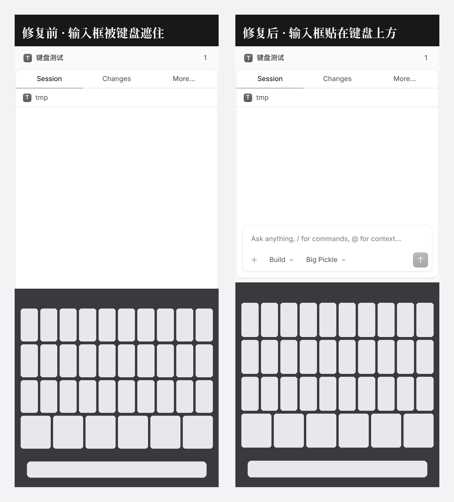

# OpenCode Mobile（Android 外壳）

[](https://github.com/alighhjj/opencode/actions/workflows/release.yml)

把 [anomalyco/opencode](https://github.com/anomalyco/opencode) 的 Web 客户端装进一个原生 Android 壳里，
手机作为远程客户端连接电脑/服务器上的 `opencode serve`。

完整可行性分析与结论见 [`FEASIBILITY.md`](FEASIBILITY.md)。

> 非官方客户端，与 opencode 官方无关联；名称与图标仅用于本地自用构建，公开发布前请替换。

## 快速开始

```bash
# 电脑端（同一局域网）
OPENCODE_PASSWORD='<strong-secret>' opencode serve --hostname 0.0.0.0 --port 4096
opencode pair          # 可选：生成一次性配对链接/二维码

# 手机端（APK 为本地构建产物，不入库）
adb install -r /path/to/OpenCode-Mobile-0.2.0-release.apk
```

打开 App → 填入 `电脑IP:4096` + 密码 → 连接。也可以直接粘贴 `opencode pair` 打印的链接。

## 发布（CI 自动构建）

打标签即发布，APK 由 GitHub Actions 从源码构建并挂到 Release：

```bash
git tag v0.2.0
git push origin v0.2.0        # 触发 .github/workflows/release.yml
```

也可以在 Actions 页手动 `Run workflow` 并填版本号——CI 会自己改 `versionCode`/`versionName`、提交、打标签，然后构建发布。

流水线做的事：JDK 17 → Android SDK 35 → `testDebugUnitTest` → `lintDebug` → `assembleRelease` → 生成 `.sha256` → 上传到 Release。

## 构建

```bash
export ANDROID_HOME=/path/to/android-sdk
export JAVA_HOME=/path/to/jdk17
./gradlew assembleRelease     # app/build/outputs/apk/release/app-release.apk
./gradlew lintDebug           # 0 error 才提交
./gradlew testDebugUnitTest   # ServerInput 解析用例
```

- Kotlin 2.0.21 / Compose M3 / AGP 8.7.3 / Gradle 8.11.1
- compileSdk 35，minSdk 26，targetSdk 35
- release 目前复用 debug keystore 签名，仅用于内测；正式分发请换私有 keystore 并开启 R8

## 结构

| 文件 | 职责 |
| --- | --- |
| `MainActivity.kt` | 边到边、Compose 入口 |
| `data/ServerInput.kt` | 地址 / 配对链接 / 二维码 JSON 解析 |
| `data/ServerStore.kt` | 最近连接持久化 |
| `ui/OpenCodeApp.kt` | 连接页 ↔ 浏览页状态机 |
| `ui/screens/ConnectScreen.kt` | 服务器地址、密码、最近列表、启动提示 |
| `ui/screens/BrowserScreen.kt` | WebView 宿主：鉴权、权限、文件选择、返回栈、错误页、键盘避让 |

## 变更记录

### 0.2.0

- **修复键盘遮挡输入框**：`targetSdk 35` 起系统不再因软键盘缩窗口，改为在 Compose 侧把
  `WindowInsets.systemBars` 与 `WindowInsets.ime` 取并集交给 WebView 容器，键盘弹起时 WebView 高度收缩，
  底部输入框（composer）始终位于键盘上方；Android 10 及以下用可见区域测量兜底。
- 连接页的地址 / 密码输入框同样避让键盘。
- 清理 lint：移除 API 27+ 才有的 `windowLightNavigationBar` 属性（运行时由 `enableEdgeToEdge` 设置）。
- 版本号 0.1.0 → 0.2.0（versionCode 2）。



## 已知限制

- 未在真机/模拟器回归（本仓库构建环境无 KVM），仅完成编译、单测与静态校验
- 密码以明文存于 SharedPreferences，仅适用于可信局域网
- 终端（PTY）在手机上的快捷键体验尚未做原生增强
